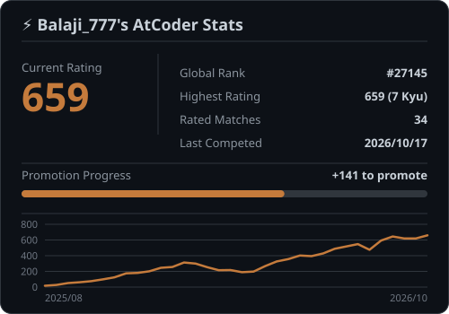

# DSA

This repository contains my solutions to a wide range of **Data Structures and Algorithms (DSA)** problems, primarily from **LeetCode**, **GeeksforGeeks** and **Codeforces**.  
It serves as both a **learning archive** and a **portfolio of my journey** in mastering algorithms and problem-solving.  

In addition to solutions, this repository automatically displays my **competitive programming stats** from:  
- 🏆 **Codeforces** – rating & contest history  
- 🔥 **LeetCode** – solved problems & contest performance  
- ⚡ **AtCoder** – ranking & participation progress  

The goal is to **track my growth as a problem solver** while preparing for **coding interviews, competitive contests, and real-world software engineering challenges**.  

  

    
    
    
  

<h2 align="center"> 📊 Competitive Programming Stats</h2>

### 🏆 Codeforces Profile

  

### 🔥 LeetCode Performance

  

### ⚡ AtCoder Rankings

 